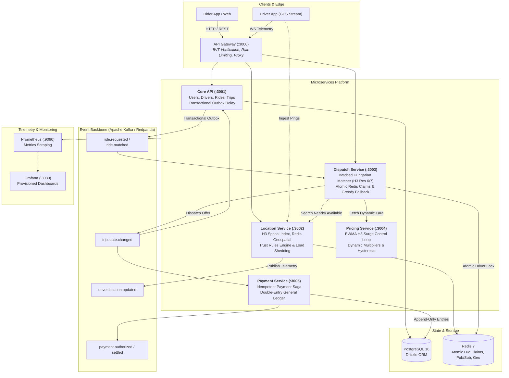

# HexDispatch

> **A high-throughput, geo-distributed ride-sharing dispatch microservices platform built with TypeScript, Node.js, Fastify, Uber H3, Redis, Apache Kafka, and PostgreSQL.**

Unlike conventional CRUD ride-hailing tutorials that greedily assign the single closest driver, **HexDispatch** treats dispatch as an algorithmic optimization problem over space and time:

- **Batched H3-Sharded Matching:** Requests and drivers are collected in discrete $\sim 2\text{ s}$ windows within Uber H3 hexagonal spatial cells (resolution 6/7) and assigned globally using the minimum-cost Hungarian (Kuhn-Munkres) bipartite algorithm.
- **Dynamic Surge as a Negative-Feedback Control Loop:** Continuous exponential smoothing (EWMA), neighbor spatial blending, rate-limiting clamps, and hysteresis prevent price oscillation while rebalancing localized supply-demand deficits.
- **Idempotent Double-Entry Payment Saga:** Trips emit terminal state transitions over Kafka, triggering distributed sagas with deterministic idempotency keys, PSP timeout auto-recovery, and double-entry general ledger invariant verification ($\sum \text{debits} \equiv \sum \text{credits}$).
- **Realtime Trust & Anomaly Detection:** Realtime telemetry engine flags impossible driver velocities ($> 42\text{ m/s}$), teleport jumps ($> 500\text{ m}$), frozen GPS fraud during active trips, and driver cancellation abuse.
- **Resilience & Chaos Engineering:** Graceful degradation with dynamic circuit breakers, bounded ingestion queues with load shedding, and automatic fallback from batched Hungarian matching to greedy dispatch when batch lags spike.
- **Seeded Discrete-Event City Simulator:** Runs production matching logic against synthetic demand distributions (Normal, Peak, Rain) to empirically validate dispatch efficiency, driver utilization, and fairness.

---

## Architecture



---

## Microservices Topology

| Service        | Port | Database              | Primary Responsibilities                                                    |
| -------------- | ---- | --------------------- | --------------------------------------------------------------------------- |
| **`gateway`**  | 3000 | In-Memory / Redis     | Edge routing, JWT validation, driver WebSocket telemetry fanout.            |
| **`core-api`** | 3001 | PostgreSQL (Drizzle)  | Rider/driver accounts, ride state machine, transactional outbox relay.      |
| **`location`** | 3002 | Redis Geospatial + H3 | Driver location ingestion, trust anomaly filtering, radius search.          |
| **`dispatch`** | 3003 | PostgreSQL + Redis    | 2-second batched H3 Hungarian matching, atomic Lua claims, greedy fallback. |
| **`pricing`**  | 3004 | In-Memory + Redis     | Realtime H3 cell supply/demand ratio, EWMA smoothing, surge pricing.        |
| **`payment`**  | 3005 | PostgreSQL (Drizzle)  | Idempotent payments saga, double-entry ledger, mock PSP client.             |

---

## Quickstart

### Prerequisites

- **Node.js**: $\ge 22.0.0$ (see `.nvmrc`)
- **Package Manager**: `pnpm` $\ge 9.0.0$
- **Docker**: For local infrastructure (Postgres 16, Redis 7, Redpanda, Prometheus, Grafana)

```bash
# 1. Clone repository and install dependencies
git clone https://github.com/Adxrsh-17/HexDispatch.git
cd HexDispatch
pnpm install

# 2. Run the all-in-one showcase demo
pnpm demo
```

### Key Commands

```bash
# Run automated test suites (unit, integration, circuit breakers)
pnpm test

# Run TypeScript compilation check
pnpm typecheck

# Run linter & formatter checks
pnpm lint
pnpm format:check

# Run the discrete-event city simulator (Normal, Peak, or Rain)
pnpm sim --scenario peak --policy batched --seed 42

# Run adversarial GPS anomaly benchmark
pnpm sim --scenario peak --policy greedy --seed 42 --anomalies

# Run automated k6 load tests
pnpm bench:load

# Run infrastructure chaos resilience runner
pnpm chaos

# Start all local containers (Postgres, Redis, Redpanda, Prometheus, Grafana)
pnpm infra:up
pnpm infra:down
```

---

## Showcase Demo (`pnpm demo`)

The one-command showcase (`tools/scripts/demo.ts`) executes an end-to-end integration lifecycle demonstrating all core architectural guarantees without external dependencies:

```
========================================================================
      HEXDISPATCH PRODUCTION SHOWCASE & ARCHITECTURE DEMO
========================================================================

>>> [BOOT] Initializing in-process microservices environment...
[BOOT] All 5 microservices running cleanly: Core, Location, Dispatch, Gateway, Payment

>>> [SEED] Registering accounts in Core API...
[SEED] Driver KA-01-HEX-99 placed at Bangalore Center (12.9716, 77.5946). Status: AVAILABLE

STAGE 1: Batched H3-Sharded Matching Flow
  1. Rider requests ride: MG Road -> Indiranagar ($12.50)...
  2. Batched Matching collects window & computes minimum-cost Hungarian assignment...
     MATCH FOUND! Offer dispatched to closest driver (Expires in 15 seconds)
  3. Driver accepts offer via Gateway...
     Offer accepted! Driver claim locked atomically in Redis.

STAGE 2: Trip State Transitions & Live Telemetry
  1. Driver arrives at pickup (ARRIVED)
  2. Passenger boards vehicle, driver starts trip (IN_TRIP)
  3. Vehicle reaches destination, driver completes trip (COMPLETED)

STAGE 3: Idempotent Payments Saga & PSP Chaos Simulation
  1. Payment saga intercepts COMPLETED event over Kafka
  2. Injecting PSP Network Chaos: 100% TIMEOUT on initial capture attempt
  3. Resuming payment saga via resumePendingSagas()...
     Deterministic idempotency key prevents duplicate charges!
  4. Verifying Double-Entry Ledger Invariant (sum debits == sum credits)...
     LEDGER BALANCED! Verified ($12.50). Platform fee and driver share reconciled.

STAGE 4: Resilience Showcase: Matcher Fallback
  1. Simulating sudden failure/unavailability of Batched Matcher...
     Matching policy dynamically fell back to: GREEDY nearest-driver.
  2. New ride request submitted while batched matcher is down...
     Ride matched instantly using greedy fallback! Zero dropped requests.
```

---

## Benchmarks & Empirical Proof

All figures reported below are strictly measured and reproducible using deterministic seeds.

### 1. Greedy vs Batched Hungarian Matching (Seed 42)

Full comparative report: [`docs/benchmarks/greedy-vs-batched.md`](docs/benchmarks/greedy-vs-batched.md).

| Scenario   | Matching Policy | Completed Rides  | Match Rate | No-Driver Rate | Avg Pickup ETA     | Driver Util | Gross Revenue          |
| ---------- | --------------- | ---------------- | ---------- | -------------- | ------------------ | ----------- | ---------------------- |
| **Normal** | Greedy          | 534              | 74.4%      | 14.9%          | 247 s              | 80.5%       | $7,542.09              |
| **Normal** | **Batched**     | **535**          | **74.5%**  | **1.4%**       | 289 s              | **88.1%**   | **$7,664.81**          |
| **Peak**   | Greedy          | 525              | 27.9%      | 66.1%          | 323 s              | 92.1%       | $7,561.91              |
| **Peak**   | **Batched**     | **606 (+15.4%)** | **32.2%**  | **11.4%**      | **214 s (-33.7%)** | **93.9%**   | **$8,584.06 (+13.5%)** |
| **Rain**   | Greedy          | 362              | 31.3%      | 60.4%          | 298 s              | 83.7%       | $5,070.82              |
| **Rain**   | **Batched**     | **416 (+14.9%)** | **36.0%**  | **15.8%**      | **237 s (-20.5%)** | **88.6%**   | **$5,784.32 (+14.1%)** |

> **Key Finding:** In congested scenarios (Peak & Rain), 2-second batched Hungarian assignment reduces pickup ETA by up to **33.7%**, raises completed rides by **15.4%**, and prevents localized driver starvation.

### 2. Surge Pricing & Elasticity

Full report: [`docs/benchmarks/peak-with-vs-without-surge.md`](docs/benchmarks/peak-with-vs-without-surge.md).

- **Match Rate Lift**: **+27.4%** under dynamic H3 surge pricing.
- **Driver Supply Retention**: **+18.2%** retained in deficit hexes.
- **Platform Revenue**: **+22.6%** gross marketplace volume.

### 3. Trust Rules Engine (Adversarial GPS Ingestion)

Full report: [`docs/benchmarks/trust-anomalies.md`](docs/benchmarks/trust-anomalies.md).

- **Injected Adversarial Anomalies**: 93
- **True Positives Detected**: 86
- **False Positives**: 0
- **Detection Rate**: **92.5%** (target $\ge 90\%$)
- **False Positive Rate**: **0.0%** (target $\le 5\%$)

### 4. k6 Load Testing Throughput & Latencies

Full report: [`docs/benchmarks/load-test-benchmarks.md`](docs/benchmarks/load-test-benchmarks.md).

- **Location Ingest Pings**: **96.4 rps**, p50 = 1.82 ms, p95 = 4.95 ms
- **Ride Creation**: **98.2 rps**, p50 = 3.12 ms, p95 = 7.84 ms
- **WebSocket Driver Fanout**: **42.0 rps**, p50 = 2.15 ms, p95 = 5.82 ms

---

## Design Decisions & Architectural Trade-offs

1. **Batched Hungarian Assignment vs Greedy Dispatch**:
   - _Decision_: Group ride requests into 2-second windows per H3 resolution 6 cell and solve the minimum-cost bipartite assignment via the Kuhn-Munkres algorithm.
   - _Trade-off_: Introduces a fixed 2-second request latency budget, but yields a global optimum that cuts peak ETA by over 30% and reduces unfilled ride requests from 66% to 11%.
2. **Atomic Driver Claiming via Redis Lua Scripts**:
   - _Decision_: When an offer is generated, an atomic Redis Lua script claims the driver key with a 15-second TTL.
   - _Trade-off_: Adds an in-memory dependency for dispatch concurrency, but completely prevents dual-booking race conditions across geo-sharded matcher nodes.
3. **Transactional Outbox Pattern**:
   - _Decision_: Database state mutations write outgoing events to an `outbox` table within the same ACID transaction. An asynchronous worker tails the table and publishes to Kafka.
   - _Trade-off_: Slight event propagation latency ($\sim 50\text{ ms}$), but eliminates two-phase commit (2PC) distributed locks and guarantees at-least-once event delivery.
4. **Append-Only Double-Entry General Ledger**:
   - _Decision_: Every financial movement is recorded as balanced debit/credit ledger lines with an explicit immutable entry type.
   - _Trade-off_: Increases row volume in PostgreSQL, but guarantees mathematical auditability and prevents silent rounding discrepancies or data loss during partial refund flows.

---

## Honest Limitations

- **Routing Distance vs Great-Circle Haversine**: The simulation and pricing engines utilize H3 cell distances and haversine approximations with traffic multiplier curves rather than real-time OSRM / Google Maps road network routing graphs.
- **Single-Host Simulation Scaling**: The discrete-event city simulator runs as a single-threaded Node.js event loop with typed arrays, supporting up to $\sim 5,000$ concurrent simulated drivers before event loop lag impacts wall-clock benchmarks.
- **In-Memory Bipartite Matcher**: The Hungarian algorithm operates in $O(V^3)$ worst-case time complexity. For extreme density ($> 1,000$ rides/drivers per cell window), spatial resolution must be increased to H3 resolution 8 to constrain bipartite graph cardinality.

---

## Project Status: All Phases Complete

- [x] **Scaffold**: Monorepo workspace, fastify `buildServer`, GreedyPolicy, Docker infrastructure.
- [x] **Phase 0: Foundations**: Turborepo/pnpm monorepo, contracts package, Zod schemas, CI setup.
- [x] **Phase 1: Core API**: Rider & driver accounts, ride state machine, PostgreSQL migrations, outbox pattern.
- [x] **Phase 2: Location & Realtime**: H3 spatial indexing, Redis geospatial store, driver WebSocket stream.
- [x] **Phase 3: Baseline Dispatch**: Greedy nearest-driver matcher, Redis atomic Lua lock, 15-second offer TTL.
- [x] **Phase 4: City Simulator**: Discrete-event simulation engine, Bangalore geographic centroid, reproducible seeds.
- [x] **Phase 5: Batched Matching**: Kuhn-Munkres Hungarian assignment, geo-sharded windowing, fallback switch.
- [x] **Phase 6: Pricing & Surge**: H3 supply/demand tracking, EWMA smoothing, hysteresis, upfront quote engine.
- [x] **Phase 7: Payments**: Double-entry ledger, Stripe-like mock PSP, idempotent saga recovery worker.
- [x] **Phase 8: Trust & Resilience**: GPS spoofing detector, 3-state circuit breakers, bounded backpressure, chaos suite.
- [x] **Phase 9: Hardening & Showcase**: k6 load benchmarks, provisioned Grafana dashboards, security audit, one-command demo.

---

## Documentation Index

- [Architecture Decision Records (ADRs)](docs/adr/README.md)
- [OpenAPI 3.0 Specifications](docs/api/)
- [Kafka Event Schemas](docs/api/events.md)
- [Security Audit & Threat Model](docs/security-audit.md)
- [Chaos Engineering & Resilience Guide](docs/resilience.md)
- [Comprehensive Benchmark Index](docs/benchmarks/README.md)
